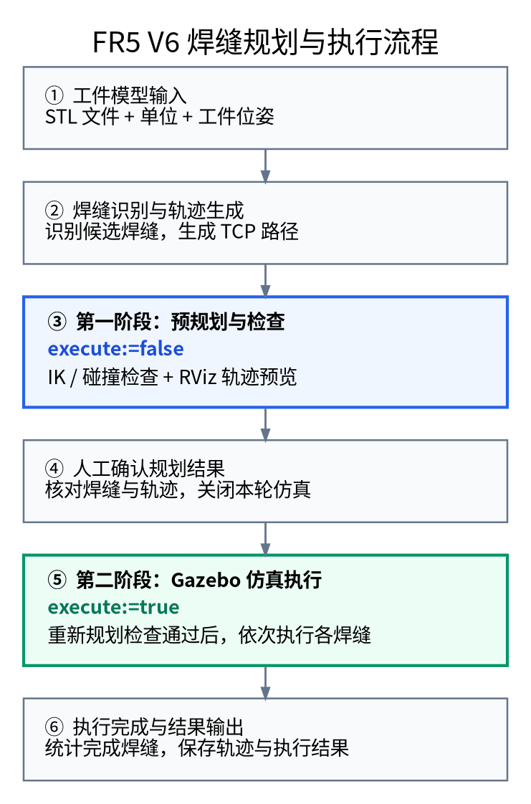
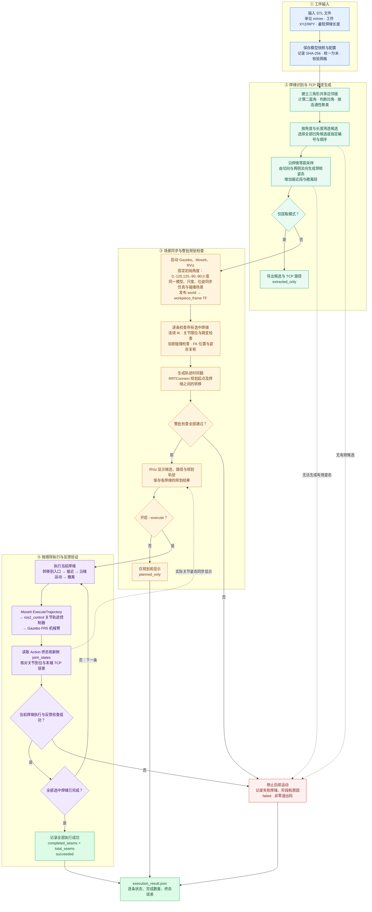

# FR5 V6 STL 多焊缝规划与仿真执行原理

## 简版流程图

先运行 `execute:=false` 进行预规划与检查，人工确认后，再运行 `execute:=true` 执行。

[SVG 矢量图](WORKFLOW_SIMPLE.svg) · [Graphviz 可编辑源文件](WORKFLOW_SIMPLE.dot)

参数对应关系：`start_weld_demo.sh` 使用 `execute:=false/true`；`start_weld_job.sh` 默认不执行，添加 `--execute` 开启执行。

## 详细流程

对应当前 `start_weld_job.sh` 实现。全部选中焊缝先通过规划检查，才允许开始运动。

## 数据与执行边界

- 候选与路径：`detected_seams.json`、`weld_path.csv`、`weld_path.yaml`，每条焊缝另存于 `seams/candidate_N/`。
- 默认只规划；显式添加 `--execute` 才发送运动命令。
- 每个执行 Action 必须成功且关节反馈到位，才发送下一条；取消、失败、终态不明或过期反馈均停止后续运动。
- “全部”指本次选中的几何候选。STL 没有焊接工艺语义，候选需要核对；当前执行的是仿真路径，不包含真实焊机起弧和送丝控制。
